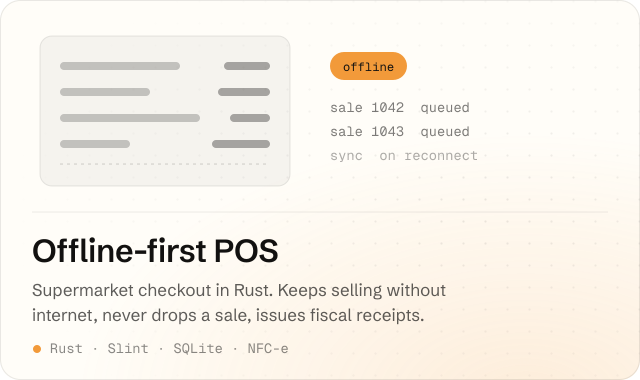
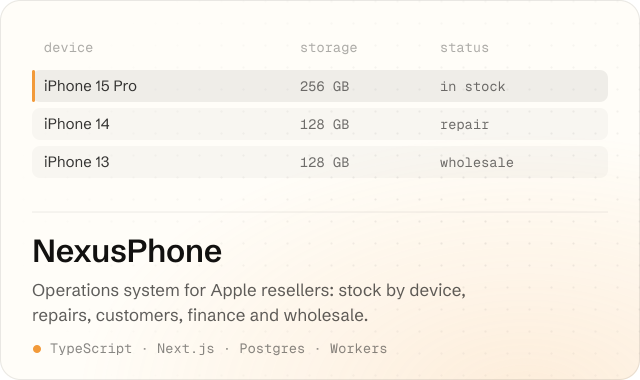
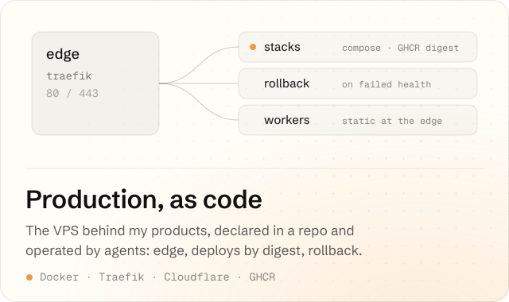
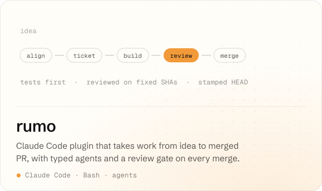
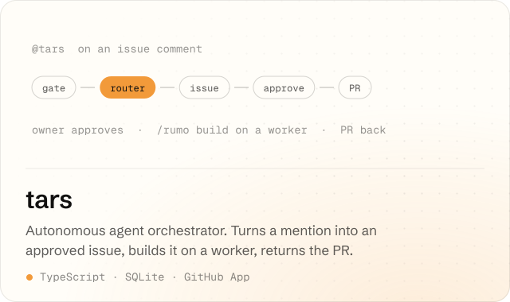

<picture>
  <source media="(prefers-color-scheme: dark)" srcset="assets/header-dark.svg">
  
</picture>

  

I work alone, so I own the whole product: the interface, the domain model, the backend, the infrastructure, and what happens in production. I build for real operations: point of sale, inventory, ad accounts, scheduling. Most of it runs in private repos, so here is the short version.

 

### Selected work

<picture><source media="(prefers-color-scheme: dark)" srcset="assets/pos-dark.svg"></picture>&nbsp;
<picture><source media="(prefers-color-scheme: dark)" srcset="assets/erp-dark.svg"></picture>

<picture><source media="(prefers-color-scheme: dark)" srcset="assets/ads-dark.svg"></picture>&nbsp;
<picture><source media="(prefers-color-scheme: dark)" srcset="assets/infra-dark.svg"></picture>

<picture><source media="(prefers-color-scheme: dark)" srcset="assets/rumo-dark.svg"></picture>&nbsp;
<picture><source media="(prefers-color-scheme: dark)" srcset="assets/tars-dark.svg"></picture>

 

### How I work

**Domain first.** Every project starts with a glossary and written decisions (ADRs) before the first screen. 
**Tests before merge.** Behaviour is pinned by tests, and every pull request passes a review gate. 
**I run what I ship.** My own edge, deploys pinned by image digest, rollback when a health check fails. 
**Agents, with guardrails.** AI agents work under the same rules as engineers: scoped tickets, typed roles, tests and review before anything merges.

 

### Stack

`TypeScript` `Next.js` `Fastify` `Rust` `Python` `FastAPI` `Kotlin` `Spring` `Postgres` `SQLite` `Docker` `Traefik` `Cloudflare Workers`

 

[vitorsolen.com](https://vitorsolen.com) &nbsp;·&nbsp; [LinkedIn](https://www.linkedin.com/in/vitorsolen)
